# Educação Continuada Gamificada — Architecture Lab B1 + AC1 (História 3QA)

**Equipe:** João Gabriel, Hector Silveira, Miguel Muran  
**Repositório:** https://github.com/JoaoLops3/DevOps_e_QA-Grupo3.git  
**Disciplina:** Modelagem e Construção de Software — Architecture Lab B1 (6,0 pontos)

Este README é o **ponto de entrada** do repositório: galeria completa do B1 (labs 1–6 + fotos) e referência da AC1 (MVP).

---

## Sumário

1. [Visão geral do B1](#1-visão-geral-do-b1)
2. [Mapa rápido (desafio → artefatos)](#2-mapa-rápido-desafio--artefatos)
3. [Lab 01 — Monólito modular](#3-lab-01--monólito-modular-spring-modulith)
4. [Lab 02 — Domínio hexagonal](#4-lab-02--domínio-hexagonal-ports--adapters)
5. [Lab 03 — IA + Circuit Breaker](#5-lab-03--serviço-python-de-ia--circuit-breaker)
6. [Lab 04 — RabbitMQ + DLQ](#6-lab-04--mensageria-assíncrona-rabbitmq--dlq)
7. [Lab 05 — MQTT + IoT Gateway](#7-lab-05--ingestão-iot-via-mqtt--iot-gateway)
8. [Lab 06 — Jenkins + Prometheus/Grafana](#8-lab-06--cicd-jenkins--observabilidade-prometheusgrafana)
9. [Diagramas C4](#9-diagramas-c4)
10. [Checklist B1](#10-checklist-b1)
11. [AC1 — User Story, BDD e MVP](#11-ac1--user-story-bdd-e-mvp)
12. [Estrutura do repositório](#12-estrutura-do-repositório)
13. [Leitura sugerida para avaliação](#13-leitura-sugerida-para-avaliação)

---

## 1. Visão geral do B1

O B1 assume o papel de Tech Lead. Cada desafio segue o padrão do enunciado:

**RF → RNF → ASR → RPC → Alternativas → ADR → C4 → Evidência**

Não há seis arquiteturas distintas. Há um **registro arquitetural vivo** e seis mini-labs que testam hipóteses sobre o mesmo produto.

| Entrega do enunciado | Onde está |
| :--- | :--- |
| Registro arquitetural + matriz de ASRs | [`docs/Arquitetura/README.md`](docs/Arquitetura/README.md) |
| ADRs (001–006) | [`docs/Arquitetura/adr/`](docs/Arquitetura/adr/) |
| C4 (PlantUML + PNG) | [`docs/Arquitetura/diagramas/`](docs/Arquitetura/diagramas/) |
| Mini-labs (código / reprodução) | [`labs/`](labs/) |
| Evidências (fotos, logs, JSON) | [`docs/evidencias/labs/`](docs/evidencias/labs/) |
| Decisões iniciais Tech Lead | [`docs/Arquitetura/EXB1_DESAFIO1_AC1/`](docs/Arquitetura/EXB1_DESAFIO1_AC1/) |

> No enunciado o caminho aparece como `/docs/arquitetura/`. Neste repositório a pasta é **`docs/Arquitetura/`**.

### Contrato de runtime

| Escopo | Conteúdo | Comando |
| :--- | :--- | :--- |
| **Raiz (MVP AC1)** | Core Spring Boot + PostgreSQL + pgAdmin | `docker compose up --build` |
| **Mini-labs B1** | `labs/lab01` … `labs/lab06` isolados | ver README de cada lab |
| **Registro B1** | ADRs, C4, evidências | leitura / navegação |

O compose da **raiz** não sobe AI Service, Mosquitto, RabbitMQ, Jenkins, Prometheus nem Grafana. Esses componentes estão no C4 alvo e são validados nos mini-labs.

---

## 2. Mapa rápido (desafio → artefatos)

| # | Decisão | ADR | Mini-lab | Evidências |
| :---: | :--- | :--- | :--- | :--- |
| **1** | Monólito modular | [ADR-001](docs/Arquitetura/adr/ADR-001-monolito-modular.md) | [lab01-spring-modulith](labs/lab01-spring-modulith/) | [lab01/](docs/evidencias/labs/lab01/) |
| **2** | Hexagonal no domínio | [ADR-002](docs/Arquitetura/adr/ADR-002-arquitetura-hexagonal.md) | [lab02-domain-isolation](labs/lab02-domain-isolation/) | [lab02/](docs/evidencias/labs/lab02/) |
| **3** | FastAPI + Circuit Breaker | [ADR-003](docs/Arquitetura/adr/ADR-003-servico-python-ia.md) | [lab03-python-circuitbreaker](labs/lab03-python-circuitbreaker/) | [lab03/](docs/evidencias/labs/lab03/) |
| **4** | RabbitMQ + DLQ | [ADR-004](docs/Arquitetura/adr/ADR-004-mensageria-assincrona.md) | [lab04-rabbitmq-resilience](labs/lab04-rabbitmq-resilience/) | [lab04/](docs/evidencias/labs/lab04/) |
| **5** | MQTT + IoT Gateway | [ADR-005](docs/Arquitetura/adr/ADR-005-integracao-iot-mqtt.md) | [lab05-mqtt-gateway](labs/lab05-mqtt-gateway/) | [lab05/](docs/evidencias/labs/lab05/) |
| **6** | Jenkins + Prometheus/Grafana | [ADR-006](docs/Arquitetura/adr/ADR-006-cicd-observabilidade.md) | [lab06-jenkins-prometheus](labs/lab06-jenkins-prometheus/) | [lab06/](docs/evidencias/labs/lab06/) |

Rastreabilidade RF/RNF/ASR/RPC: seções 6 e 7 de [`docs/Arquitetura/README.md`](docs/Arquitetura/README.md).

---

## 3. Lab 01 — Monólito modular (Spring Modulith)

**Hipótese:** o Spring Modulith valida as fronteiras entre `ranking`, `courses` e `badges`. Dependência ilegal para `ranking.internal` falha o build — **ASR-01 / ASR-02**.

| Artefato | Link |
| :--- | :--- |
| Mini-lab | [`labs/lab01-spring-modulith/`](labs/lab01-spring-modulith/) |
| ADR | [ADR-001](docs/Arquitetura/adr/ADR-001-monolito-modular.md) |
| Evidências | [`docs/evidencias/labs/lab01/`](docs/evidencias/labs/lab01/) |
| Reprodução | `../../mvnw -f pom.xml test -Dtest=ModularityTests` |

### Foto

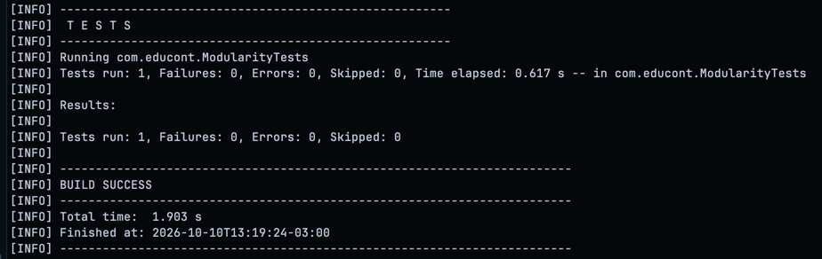

### Outros artefatos

`modularity_tests.log`, `com.educont.ModularityTests.txt`, `com.educont.ModularityTests-output.txt`

---

## 4. Lab 02 — Domínio hexagonal (Ports & Adapters)

**Hipótese:** regras de gamificação em Java puro atrás de `RewardPersistencePort`, sem Spring/JPA no teste — **ASR-03 / ASR-04**.

| Artefato | Link |
| :--- | :--- |
| Mini-lab | [`labs/lab02-domain-isolation/`](labs/lab02-domain-isolation/) |
| ADR | [ADR-002](docs/Arquitetura/adr/ADR-002-arquitetura-hexagonal.md) |
| Evidências | [`docs/evidencias/labs/lab02/`](docs/evidencias/labs/lab02/) |
| Reprodução | `../../mvnw -f pom.xml test` |

### Foto

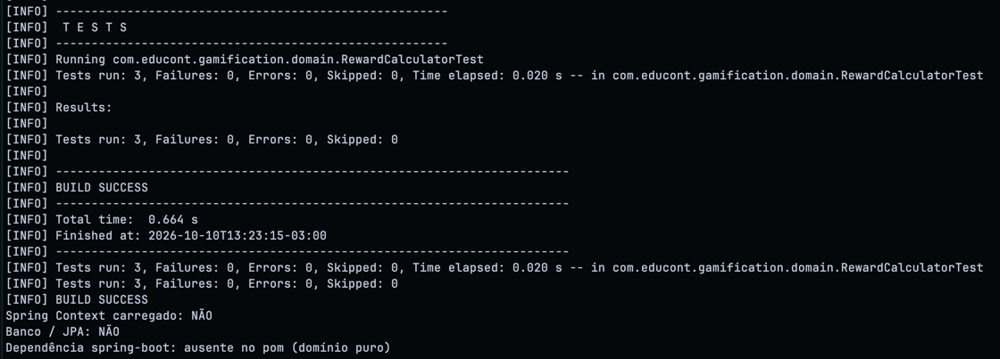

### Outros artefatos

`domain_tests.log`, `resumo.txt`, `com.educont.gamification.domain.RewardCalculatorTest.txt`

---

## 5. Lab 03 — Serviço Python de IA + Circuit Breaker

**Hipótese:** com o FastAPI indisponível, o Circuit Breaker abre e o fallback degrada sem bloquear a conclusão de curso — **ASR-05 / ASR-06**.

| Artefato | Link |
| :--- | :--- |
| Mini-lab | [`labs/lab03-python-circuitbreaker/`](labs/lab03-python-circuitbreaker/) |
| ADR | [ADR-003](docs/Arquitetura/adr/ADR-003-servico-python-ia.md) |
| Evidências | [`docs/evidencias/labs/lab03/`](docs/evidencias/labs/lab03/) |
| Reprodução | `docker compose` + `core_circuit_breaker_demo.py` |

### Fotos

**CLOSED** (IA disponível):

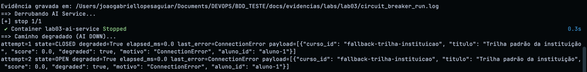

**OPEN** (degradação graciosa):

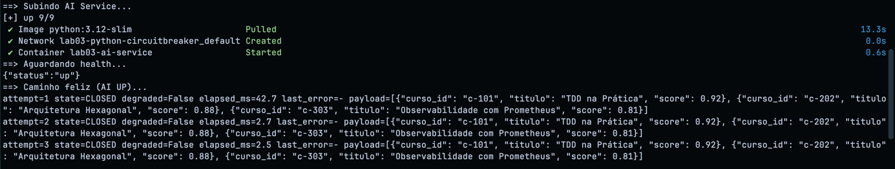

### Outros artefatos

`circuit_breaker_run.log`, `run_ai_up.log`, `run_ai_down.log`, `ai_health_up.json`

---

## 6. Lab 04 — Mensageria assíncrona (RabbitMQ + DLQ)

**Hipótese:** com o consumidor desligado, o publisher acumula eventos `CursoConcluidoEvent` na fila sem perda — **ASR-07 / ASR-08**.

| Artefato | Link |
| :--- | :--- |
| Mini-lab | [`labs/lab04-rabbitmq-resilience/`](labs/lab04-rabbitmq-resilience/) |
| ADR | [ADR-004](docs/Arquitetura/adr/ADR-004-mensageria-assincrona.md) |
| Evidências | [`docs/evidencias/labs/lab04/`](docs/evidencias/labs/lab04/) |
| Reprodução | `docker compose` + `publisher/publish_events.py` |

### Foto

Management UI — fila com consumer OFF (`queue_depth.txt`: **ready=150** após reexecuções de 50):


### Outros artefatos

`publish_run.log`, `queue_depth.txt`

---

## 7. Lab 05 — Ingestão IoT via MQTT + IoT Gateway

**Hipótese:** QoS 1 no Mosquitto + gateway MQTT→AMQP com deduplicação `(deviceId, seq)` — **ASR-09 / ASR-10**.

| Artefato | Link |
| :--- | :--- |
| Mini-lab | [`labs/lab05-mqtt-gateway/`](labs/lab05-mqtt-gateway/) |
| ADR | [ADR-005](docs/Arquitetura/adr/ADR-005-integracao-iot-mqtt.md) |
| Evidências | [`docs/evidencias/labs/lab05/`](docs/evidencias/labs/lab05/) |
| Reprodução | `docker compose` + `iot_gateway.py` / `iot_sensor_simulator.py` |

### Foto

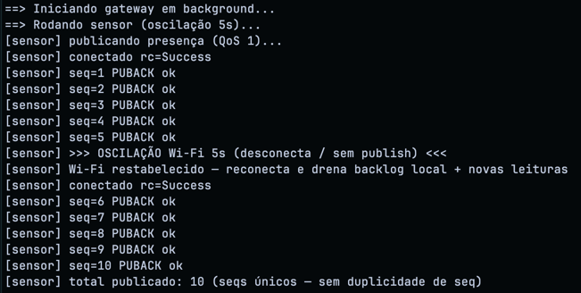

### Outros artefatos

`gateway.log`, `sensor_run.log`, `fluxo_resumo.log`

---

## 8. Lab 06 — CI/CD (Jenkins) + Observabilidade (Prometheus/Grafana)

**Hipótese:** pipelines autônomas (`pipeline-core`, `pipeline-ai`, `pipeline-gateway`) com Quality Gate (**ASR-11**); Prometheus + Grafana observam latência/throughput sob carga (**ASR-12**).

| Artefato | Link |
| :--- | :--- |
| Mini-lab | [`labs/lab06-jenkins-prometheus/`](labs/lab06-jenkins-prometheus/) |
| ADR | [ADR-006](docs/Arquitetura/adr/ADR-006-cicd-observabilidade.md) |
| Evidências | [`docs/evidencias/labs/lab06/`](docs/evidencias/labs/lab06/) |
| Reprodução | `docker compose` + `./trigger_pipelines.sh` + carga |

### Fotos — Jenkins (ASR-11)

**Dashboard dos três jobs:**

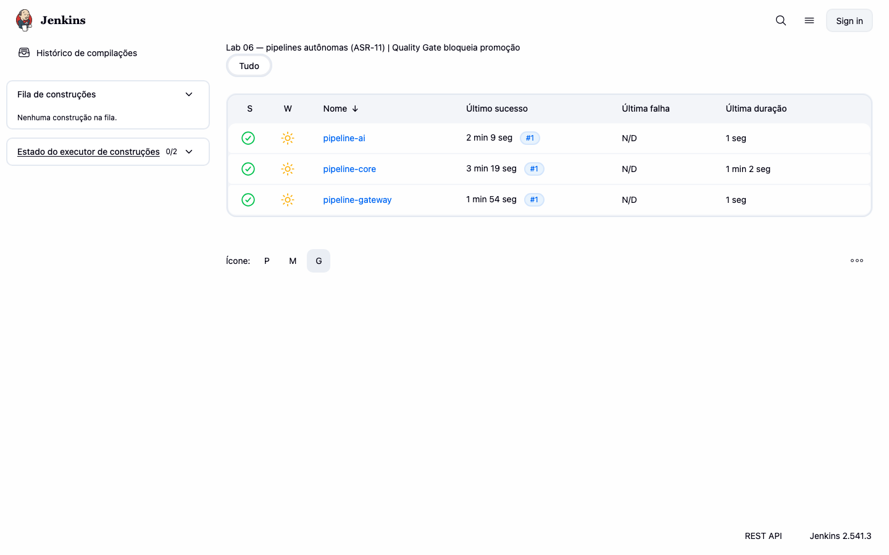

**Pipeline-core SUCCESS:**

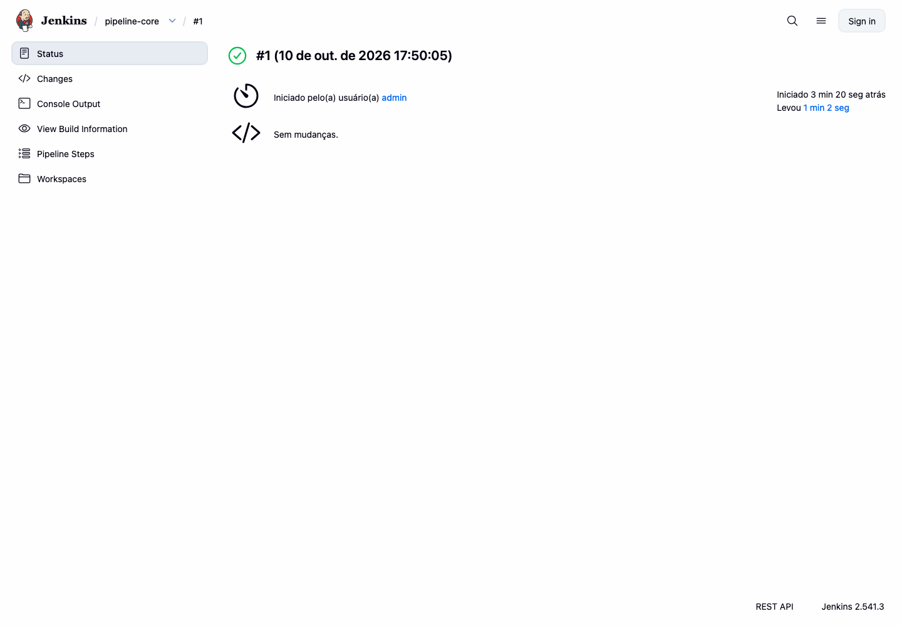

**Estágios Build → Test → Quality Gate:**

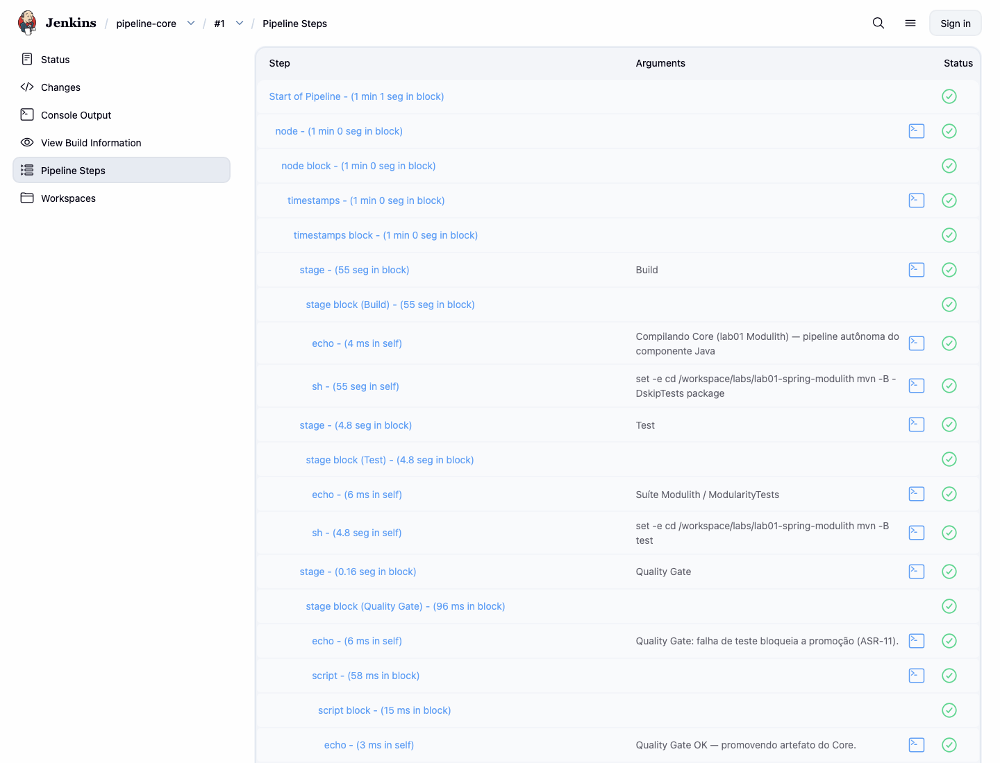

**Console pipeline-core:**

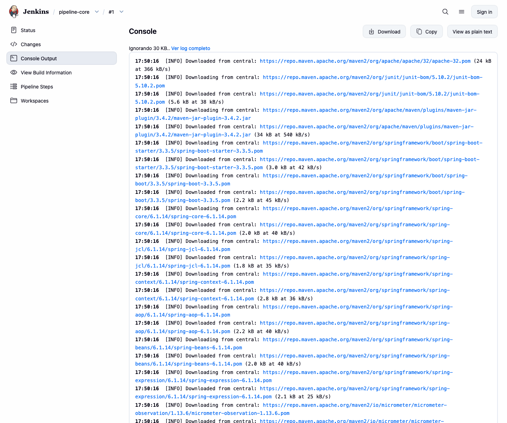

**Terminal do lab:**

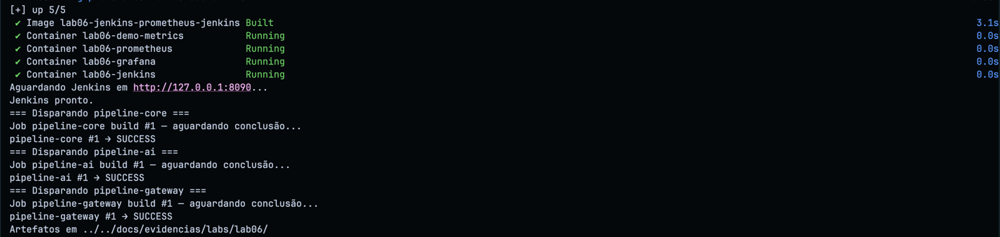

### Prometheus / Grafana (ASR-12)

Sem captura PNG de painel Grafana — comprovação via artefatos versionados:

| Arquivo | O que comprova |
| :--- | :--- |
| `prometheus_up.json` | Target `lab06-demo` UP (`"1"`) |
| `prometheus_p95.json` | Query de latência p95 |
| `load_test.log` | Carga contra `demo-metrics` |
| `grafana_acesso.txt` | URL Grafana + datasource Prometheus |
| `demo_health.json` | Health do serviço instrumentado |

### Outros artefatos

`pipeline-core_console.log`, `pipeline-ai_console.log`, `pipeline-gateway_console.log`, `jenkins_jobs.json`, `quality_gate_readme.txt`

---

## 9. Diagramas C4

Fonte (`.puml` + PNG): [`docs/Arquitetura/diagramas/`](docs/Arquitetura/diagramas/)  
Cópia em evidências: [`docs/evidencias/labs/c4/`](docs/evidencias/labs/c4/)

| Nível | PNG |
| :--- | :--- |
| Container | [`c4-container-overview.png`](docs/Arquitetura/diagramas/c4-container-overview.png) |
| Component (Core) | [`c4-component-core.png`](docs/Arquitetura/diagramas/c4-component-core.png) |
| Sequence (D4) | [`c4-sequence-desafio4.png`](docs/Arquitetura/diagramas/c4-sequence-desafio4.png) |
| Deployment (D6) | [`c4-deployment.png`](docs/Arquitetura/diagramas/c4-deployment.png) |

### Container


### Component (Core)

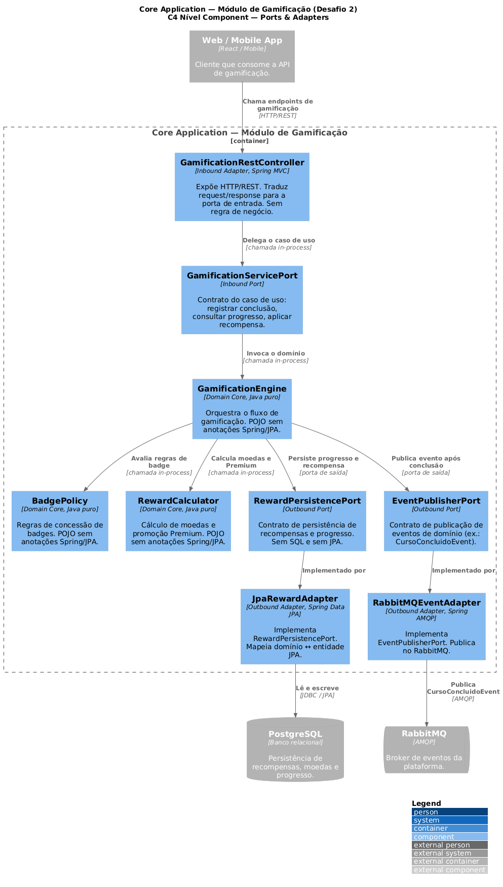

### Sequence (Desafio 4)


### Deployment (Desafio 6)

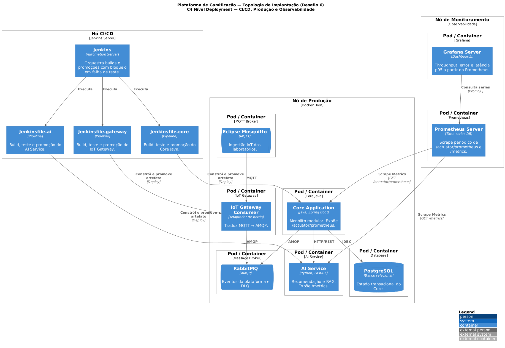

---

## 10. Checklist B1

- [x] Link do repositório e identificação da equipe
- [x] README arquitetural com as seis decisões e matriz de ASRs — [`docs/Arquitetura/README.md`](docs/Arquitetura/README.md)
- [x] ADRs essenciais — [`docs/Arquitetura/adr/`](docs/Arquitetura/adr/)
- [x] C4 coerente (Container, Component, Sequence, Deployment) — seção [9](#9-diagramas-c4)
- [x] Mini-labs — [`labs/`](labs/)
- [x] Evidências versionadas com fotos por lab — seções [3](#3-lab-01--monólito-modular-spring-modulith)–[8](#8-lab-06--cicd-jenkins--observabilidade-prometheusgrafana)
- [x] Síntese para a PoC da AF — seção 5 de [`docs/Arquitetura/README.md`](docs/Arquitetura/README.md)

---

## 11. AC1 — User Story, BDD e MVP

### User Story 3QA

| Campo | Conteúdo |
|--------|----------|
| Código | **3QA** |
| Redação | Miguel Muran |
| US | COMO usuário da assinatura básica, QUERO visualizar quantos cursos já concluí e quantos faltam para os 12 necessários, PARA ter clareza sobre minha evolução e o que falta para virar Premium |

### BDD por integrante

| Integrante | Cenário |
|------------|---------|
| João Gabriel | Exibir concluídos e faltantes para os 12 |
| Hector Silveira | Promover para Premium + 3 moedas ao atingir 12 |
| Miguel Muran | Não contabilizar curso com média &lt; 7,0 |

### Regras de negócio

1. Todo aluno nasce **BASICA** com **0 moedas**.
2. Só conta no progresso se **média ≥ 7,0**.
3. Progresso: concluídos, faltantes (meta = 12), assinatura, moedas.
4. Ao atingir **12** válidos → **PREMIUM** + **3 moedas**.

### Como rodar o MVP

```bash
docker compose up --build
```

| Serviço | URL / acesso |
|---------|----------------|
| Vue + API | http://localhost:8080/ |
| Swagger | http://localhost:8080/swagger-ui.html |
| Postgres | `localhost:5432` · `progresso_db` / `progresso` |
| pgAdmin | http://localhost:5050/ · `admin@progresso.com` / `admin` |

> Credenciais só para lab local. Detalhes: [`docker/README.md`](docker/README.md).

**App via Maven** (Postgres no Docker):

```bash
docker compose up -d postgres
./mvnw spring-boot:run
```

**Testes / JaCoCo (domain 100%):**

```bash
./mvnw test && ./mvnw verify
```

### API (resumo)

| Método | Rota | Função |
|--------|------|--------|
| POST | `/api/alunos` | Cria aluno (BASICA) |
| GET | `/api/alunos` | Lista alunos |
| GET | `/api/alunos/{id}` | Busca por id |
| POST | `/api/alunos/{id}/conclusoes` | Registra curso e recalcula promoção |
| GET | `/api/alunos/{id}/progresso` | Consulta progresso |

### Evidências AC1

| Tipo | Pasta |
| :--- | :--- |
| User Stories / BDD | [`docs/evidencias/us-bdd/`](docs/evidencias/us-bdd/) |
| Banco | [`docs/evidencias/banco/`](docs/evidencias/banco/) |
| TDD RED | [`docs/evidencias/red/`](docs/evidencias/red/) |
| TDD GREEN | [`docs/evidencias/green/`](docs/evidencias/green/) |
| TDD BLUE | [`docs/evidencias/blue/`](docs/evidencias/blue/) |

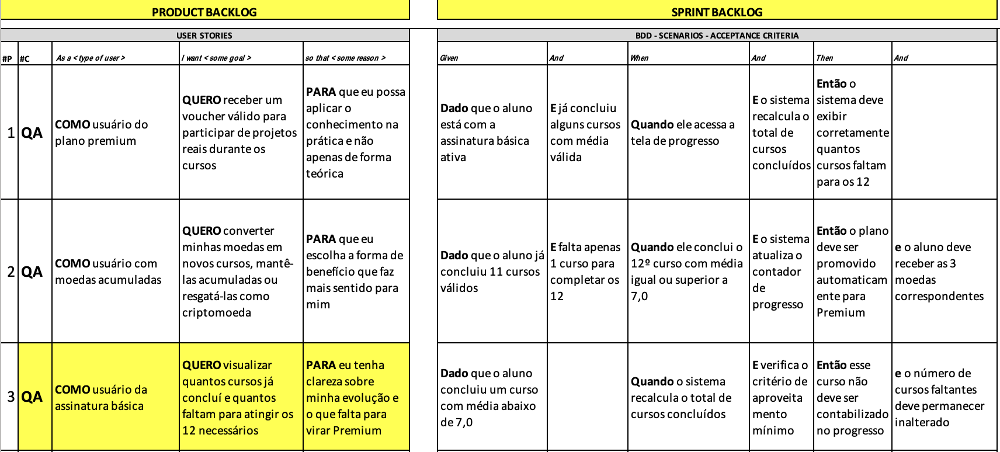

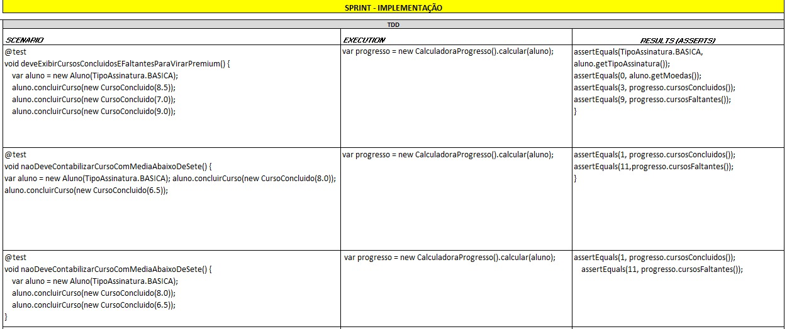


### Checklist AC1

- [x] Pacote `domain` + classes de domínio
- [x] Pacote `domaintest` + 3 BDDs (João / Hector / Miguel)
- [x] JaCoCo 100% no `domain`
- [x] Evidências RED / GREEN / BLUE / US-BDD
- [x] Entity, DTO, Repository, Service, Controller
- [x] Swagger / OpenAPI
- [x] Frontend Vue.js (CDN) em `/`
- [x] PostgreSQL (sem H2)
- [x] Docker + compose (app + Postgres + pgAdmin)

---

## 12. Estrutura do repositório

```
├── README.md                          # Este arquivo (hub B1 + AC1)
├── src/                               # Core Spring Boot (MVP AC1)
├── frontend/                          # Vue (Maven copia para static/)
├── docker-compose.yml                 # MVP: app + Postgres + pgAdmin
├── docs/
│   ├── Arquitetura/                   # ADRs, C4, registro vivo, ASRs
│   └── evidencias/
│       ├── labs/                      # Fotos/logs B1 (lab01…lab06 + c4)
│       ├── red/ green/ blue/          # TDD AC1
│       ├── us-bdd/                    # User Stories / BDD
│       └── banco/                     # Capturas PostgreSQL
└── labs/
    ├── lab01-spring-modulith/         # D1
    ├── lab02-domain-isolation/        # D2
    ├── lab03-python-circuitbreaker/   # D3
    ├── lab04-rabbitmq-resilience/     # D4
    ├── lab05-mqtt-gateway/            # D5
    └── lab06-jenkins-prometheus/      # D6
```

**Como achar as fotos:** cada lab tem pasta espelhada em `docs/evidencias/labs/lab0N/`. A galeria embutida está neste README (seções 3–9).

---

## 13. Leitura sugerida para avaliação

1. Este README — seções **1–10** (B1 completo com fotos).
2. [`docs/Arquitetura/README.md`](docs/Arquitetura/README.md) — ASRs, rastreabilidade, síntese AF.
3. ADRs em [`docs/Arquitetura/adr/`](docs/Arquitetura/adr/).
4. Reprodução opcional: `README.md` de cada pasta em [`labs/`](labs/).
5. AC1 (se necessário): seção [11](#11-ac1--user-story-bdd-e-mvp).
