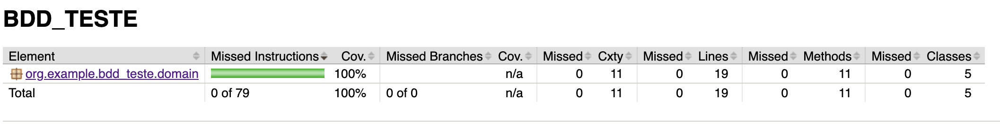
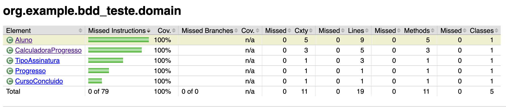

# Evidências TDD — BLUE

Fase BLUE da História 3QA (progresso da assinatura básica).  
Código de domínio refatorado; testes passando com cobertura **100%** (sem vermelho/amarelo no JaCoCo).

## Como foi executado

Executado pelo **Maven do IntelliJ IDEA Ultimate**.

- IDE: IntelliJ IDEA 2026.2.1
- Goals: `test` / `verify` (`pom.xml`) — `verify` gera o relatório JaCoCo
- Equivalente no terminal: `./mvnw test` e `./mvnw verify`

## Resultado

```
[INFO] Running org.example.bdd_teste.domaintest.CalculadoraProgressoTest
[INFO] Tests run: 1, Failures: 0, Errors: 0, Skipped: 0

[INFO] Results:

[INFO] Tests run: 1, Failures: 0, Errors: 0, Skipped: 0

[INFO] BUILD SUCCESS
[INFO] Finished at: 2026-09-12T17:51:46-03:00
```

## O que foi validado

| Item | Valor |
|------|--------|
| Classe | `CalculadoraProgressoTest` |
| Método | `deveExibirCursosConcluidosEFaltantesParaVirarPremium` |
| Fase | **BLUE** |
| Cenário | Aluno básico com 3 cursos válidos |
| Esperado | 3 concluídos e 9 faltantes para os 12 |
| Status | **PASSOU** |
| JaCoCo | **100%** (Application excluída do relatório; só Domain) |

## Cobertura JaCoCo

### Página 1 — `target/site/jacoco/index.html`

No BLUE: cobertura **100%**, sem vermelho ou amarelo.



| Pacote | Cov. |
|--------|------|
| `org.example.bdd_teste.domain` | **100%** |
| **Total** | **100%** (0 of 79 missed) |

### Página 2 — pacote `domain`



| Elemento | Cov. |
|----------|------|
| `Aluno` | **100%** |
| `CalculadoraProgresso` | **100%** |
| `TipoAssinatura` | **100%** |
| `Progresso` | **100%** |
| `CursoConcluido` | **100%** |
| **Total do pacote** | **100%** |
