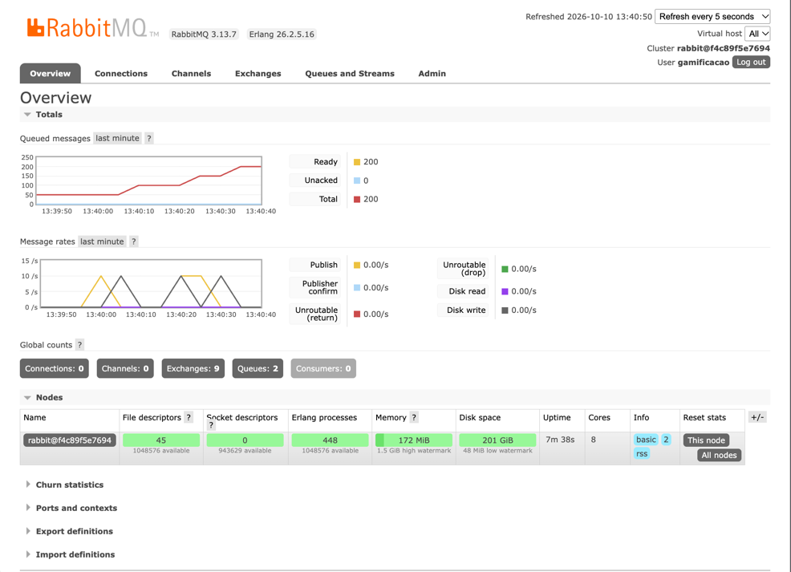
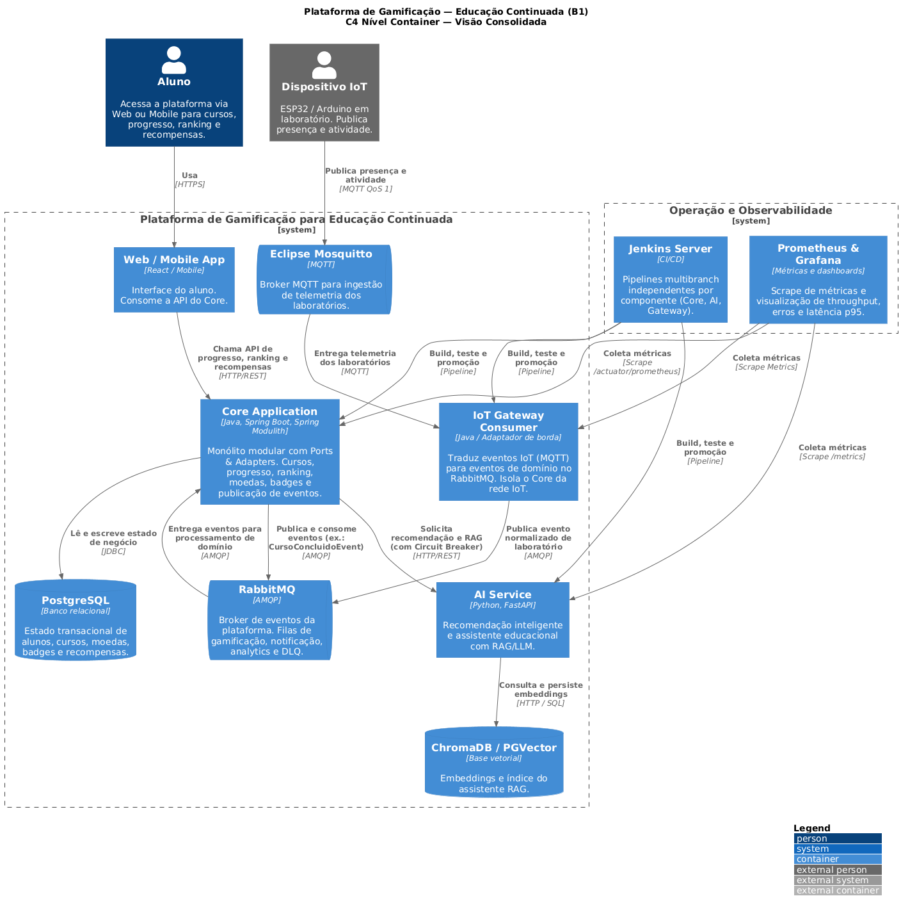
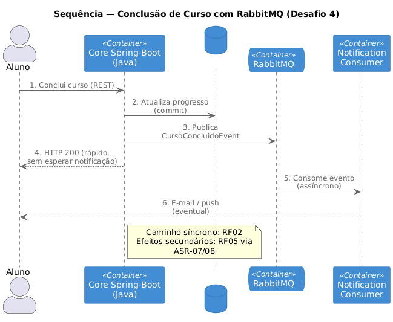

# Evidências dos mini-labs — Architecture Lab B1

**Índice canônico das capturas B1.** Os READMEs da raiz e de cada lab apontam para cá; evite duplicar a galeria completa em outros arquivos.

Artefatos de execução dos desafios (logs, Surefire e capturas dos ambientes de validação).

| Lab | Pasta | Hipótese | Artefatos |
| :--- | :--- | :--- | :--- |
| 01 Modulith | [lab01/](./lab01/) | Fronteiras do monólito modular | logs Surefire, `modulith_verify_ok.png` |
| 02 Domínio | [lab02/](./lab02/) | Domínio hexagonal sem Spring/JPA | logs Surefire, `domain_tests_ok.png` |
| 03 Circuit Breaker | [lab03/](./lab03/) | Degradação graciosa da IA | `circuit_breaker_run.log`, capturas CLOSED/OPEN |
| 04 RabbitMQ | [lab04/](./lab04/) | Eventos assíncronos com fila/DLQ | `publish_run.log`, `queue_depth.txt` (ready=150), Management UI |
| 05 MQTT | [lab05/](./lab05/) | Ingestão IoT via gateway | `gateway.log`, `sensor_run.log`, captura do fluxo |
| 06 Observabilidade | [lab06/](./lab06/) | Pipelines Jenkins + Prometheus/Grafana | jobs SUCCESS, Quality Gate, `prometheus_*.json`, carga |
| C4 | [c4/](./c4/) | Diagramas arquiteturais exportados | `c4-*.png` |

O `docker compose` da raiz sobe apenas o MVP (Core + PostgreSQL + pgAdmin). Os componentes do C4 (IA, brokers, observabilidade) são validados nos mini-labs em `labs/`.

---

## Lab 01 — Modulith

## Lab 02 — Domínio hexagonal

## Lab 03 — Circuit Breaker

## Lab 04 — RabbitMQ

Publisher padrão: 50 eventos/execução. Evidência de profundidade: `queue_depth.txt` com **ready=150** (reexecuções com consumer OFF). Captura Management UI:

## Lab 05 — MQTT Gateway

## Lab 06 — Jenkins + Prometheus / Grafana

### Jenkins (ASR-11)

### Prometheus / Grafana (ASR-12)

Sem capturas PNG de painel nesta pasta — comprovação via artefatos versionados:

| Arquivo | Conteúdo |
| :--- | :--- |
| `prometheus_up.json` | Target UP (`"1"`) |
| `prometheus_p95.json` | Latência p95 |
| `load_test.log` | Simulação de carga |
| `grafana_acesso.txt` | URL e datasource |
| `demo_health.json` | Health do `demo-metrics` |

## C4

