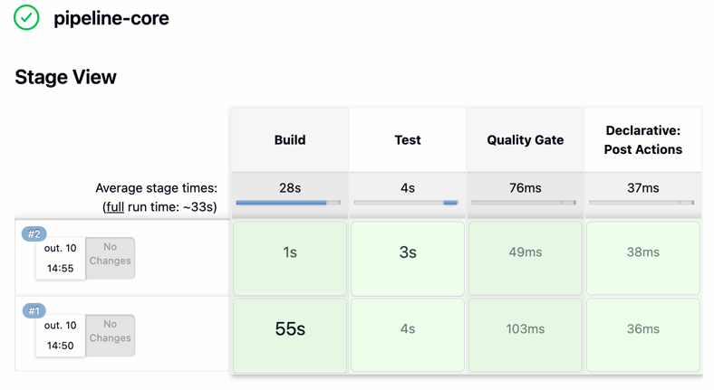
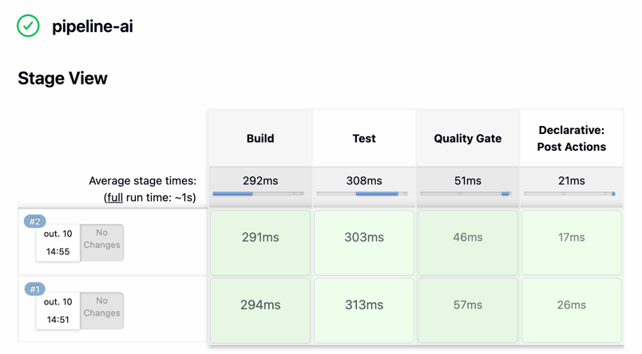
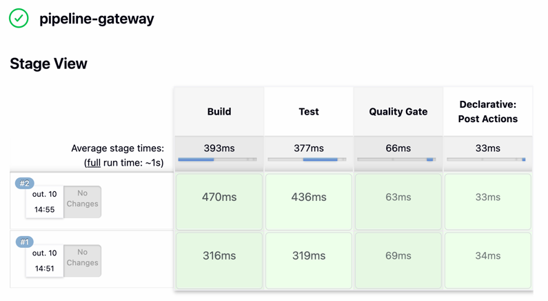
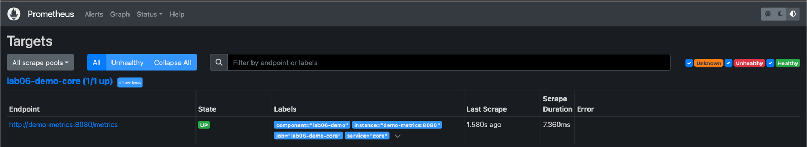
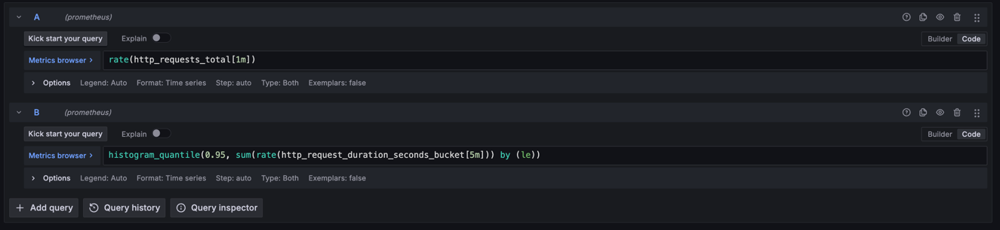
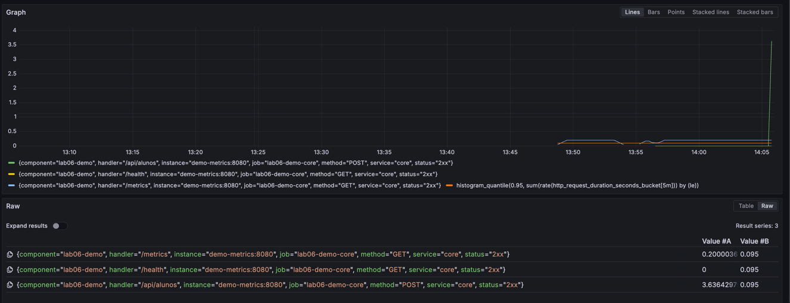

# Mini-Lab 06: CI/CD Independente (Jenkins) + Observabilidade

## Hipótese arquitetural

Pipelines autônomas (`pipeline-core`, `pipeline-ai`, `pipeline-gateway`) com Quality Gate — **ASR-11**.  
Prometheus e Grafana observam latência e throughput sob carga — **ASR-12** (ADR-006).

O serviço `demo-metrics` não substitui o MVP da raiz; serve à prova de scrape e painéis no laboratório.  
O Jenkins sobe no mesmo compose (porta **8090**) e cria os três jobs a partir dos `Jenkinsfile*`.

## Execução

```bash
cd labs/lab06-jenkins-prometheus
docker compose up -d --build
# Aguardar health do Jenkins (primeiro build baixa plugins)
./trigger_pipelines.sh
BASE_URL=http://127.0.0.1:8088 ./load-test/simular_carga.sh
```

| Serviço | URL |
| :--- | :--- |
| Jenkins | http://localhost:8090 — `admin` / `admin` |
| Jobs | `/job/pipeline-core`, `/job/pipeline-ai`, `/job/pipeline-gateway` |
| Demo metrics (carga) | http://localhost:8088/health |
| Prometheus Targets | http://localhost:9090/targets |
| Grafana | http://localhost:3000 — `admin` / `admin`; datasource `http://prometheus:9090` |

Pasta de artefatos: [`docs/evidencias/labs/lab06/`](../../docs/evidencias/labs/lab06/)

## Critério de aceite

- Três jobs Pipeline no Jenkins com estágios Build → Test → Quality Gate
- Builds com resultado SUCCESS (Quality Gate não bloqueou)
- Target Prometheus em estado UP
- Gráficos Grafana de throughput e/ou latência p95 após a carga
- Evidência em `docs/evidencias/labs/lab06/`

## Evidências

### ASR-11 — Jenkins (pipelines autônomas + Quality Gate)

Dashboard com os três jobs verdes (`pipeline-ai`, `pipeline-core`, `pipeline-gateway`):


Build `#1` do `pipeline-core` (SUCCESS):


Estágios Build → Test → Quality Gate (`pipeline-core`):


Console com Quality Gate OK:


Stage View por job:

| Job | Stage View |
| :--- | :--- |
| pipeline-core |  |
| pipeline-ai |  |
| pipeline-gateway |  |

Logs de console: `pipeline-core_console.log`, `pipeline-ai_console.log`, `pipeline-gateway_console.log`.

### ASR-12 — Prometheus / Grafana

Targets Prometheus UP:



Queries de throughput / latência p95:



Gráfico Grafana (throughput e latência p95):


